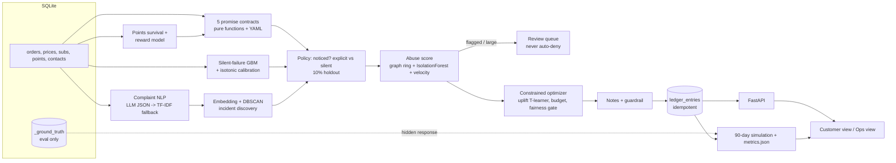

# Kept

> Every loyalty program keeps a ledger of what customers owe the brand. This is the other half: **what the brand owes the customer, paid before they ask.**

Hackathon prototype for *Loyalty Lab: Turn Data into Devotion*. **All data is synthetic and every result depends on an assumed response function.** Nothing here is evidence of real-world impact.

## Run it

```bash
pip install -r requirements.txt
python run.py            # seed -> train -> detect+settle -> simulate -> serve   (~40 s on CPU)
# open http://127.0.0.1:8000   (API docs: /docs)
```

`make run` does the same; `make test` runs the 88 tests; `docker compose up` works too.
Options: `python run.py --no-serve`, `--port 9000`, `--wedge` (only the contracts the economics support). Everything is local and offline. No API key needed.

Optional extras (the demo runs without them): `KEPT_LLM=1` + `ANTHROPIC_API_KEY` (and `pip install anthropic`) enables LLM complaint extraction and LLM-phrased notes. `KEPT_EMBED=st` uses sentence-transformers MiniLM embeddings.

## Run it as an app

| Way | How | Good for |
|---|---|---|
| **Installable app (PWA)** | Start the server, open http://127.0.0.1:8000 in Chrome or Edge, click **Install app** (top right, or the install icon in the address bar). It gets its own icon and window; on a phone use "Add to Home screen" (the server must be reachable from the phone, e.g. same Wi-Fi with `python run.py --host-all`) | a real app feel, phone and desktop |
| **One-click desktop launch (Windows)** | Double-click `run.bat`. First run builds the data (about 1 minute), later runs open in seconds in an Edge/Chrome app window without tabs | demos |
| **Command line** | `python run.py --serve-only --app` (app window) or `--open` (normal browser tab); `--serve-only` keeps your existing ledger state instead of rebuilding | development |

### Show it on a phone (this computer is the server)

1. Connect the phone to the **same Wi-Fi** as the computer.
2. On the computer double-click `share.bat` (or run `python run.py --serve-only --share --pin 1234 --open`). It prints the addresses, for example `http://192.168.131.44:8000`; try the one marked "try this first". The app's **Phone** button shows them too.
3. Open that address in the phone browser and enter the PIN.
4. The first time, Windows asks whether to allow Python through the firewall: tick **Private networks**. If it never asked, run once in an *administrator* terminal: `netsh advfirewall firewall add rule name="Kept" dir=in action=allow protocol=TCP localport=8000 profile=private`.
5. Keep the computer awake and plugged in while presenting (Windows sleep drops the connection).

Things to know: `--pin` is a casual demo gate (shared PIN, plain HTTP, no accounts), not real security; without it anyone on the same network can approve or deny entries, so use it on any Wi-Fi you do not fully control. Over plain `http://` a phone can open and use the app, but **"Install app" needs HTTPS** (the install button only appears on localhost or HTTPS). For a true installed app on the phone, put the server behind an HTTPS tunnel or use Chrome's "Insecure origins treated as secure" flag for your computer's address. If the address changes between sessions, `http://<computer-name>.local:8000` often keeps working. Layout was checked with real 390 px mobile emulation: no horizontal overflow in the Customer, Operations, Review queue and Experiment views.

Notes: the app still needs the Python server running; the installed shell shows a "Cannot reach the server" message otherwise. The service worker caches only the static shell (page, icons, manifest). **Live data and every write (approve, deny, simulate, run) always go straight to the server and are never cached**, so the app cannot show stale ledger numbers. App shortcuts `/?view=ops` and `/?view=cust` open a view directly. Icons are generated by `python scripts/make_icons.py`. For hosting online, the `Dockerfile` honours `$PORT` (`python run.py --host-all`); the first start builds the data, so allow about a minute.

## Data (not stored in this repository)

The synthetic demo needs no downloads: `python run.py` generates everything. The optional real-data analyses read datasets that are **not** included here (size and licences). Download them yourself and unzip into `data/`; `python run.py` skips any that are missing.

| Folder | Dataset | Source | Licence |
|---|---|---|---|
| `data/olist/` | Brazilian E-Commerce Public Dataset by Olist (9 CSVs) | Kaggle `olistbr/brazilian-ecommerce` | CC BY-NC-SA 4.0 (non-commercial) |
| `data/dunnhumby/processed/` | Dunnhumby The Complete Journey (parquet files) | dunnhumby / Kaggle | check the source's terms |
| `data/twcs/twcs/twcs.csv` | Customer Support on Twitter | Kaggle `thoughtvector/customer-support-on-twitter` | check the source's terms |

`data/` is git-ignored, so generated databases, models and metrics are never committed. The Kaggle fraud-dataset-benchmark archive that was also tried is loader code (it downloads data from Kaggle) and is not used.

## What it does

Five **promise contracts** (YAML, editable without code) compare what the brand promised with what happened, per customer, and write an **IOU** into a customer-visible ledger that settles automatically:

| Contract | Rule |
|---|---|
| late_delivery | delay > 30 min, graduated bands (30-60 / 60-180 / 180+), capped at $5 |
| price_protection | price drop within 14 days -> refund the difference |
| expiring_points | expiring within 7 days, balance >= 500, **member unlikely to redeem (survival model)** -> auto-convert to their likely reward |
| unused_subscription | no use for 60 days -> pause + prorated credit. *Experimental; silent; never an "overpaying" alert* |
| devaluation_true_up | reward chart makes a member's usual reward dearer -> restore the lost purchasing power |

Detectors add: a **calibrated silent-failure model** (likely-damaged orders with no telemetry) and **embedding-based incident discovery** (one complaint cluster credits *everyone* hit, including customers who never complained).

Two design rules are enforced in code and tests, not just documented:
1. **Settle in value, never in words.** Notes are factual templates; a validator rejects apology/promise language and changed amounts (LLM notes fall back to the template).
2. **Salience-aware settlement.** Failure the customer noticed (contacted support, tracked repeatedly, delay > 120 min, public change) -> explicit credit with a short note. Not noticed -> silent credit that just appears.

## Architecture



Layout: `kept/contracts` (pure functions), `kept/detector` (NLP, incidents, silent failure, points), `kept/abuse`, `kept/policy` (settlement, uplift, optimizer, notes), `kept/eval` (training, hidden response, simulation, model cards), `kept/api.py`, `kept/static/index.html`, `tests/`.

## Results from the last run (synthetic, seed 42)

Real numbers, including the unflattering ones. Weaknesses found in review and what was done about them are in the next section.

| Metric | Result |
|---|---|
| Auto-settlement coverage (treatment arm) | 87% (rest held for review); 82% settled with zero customer contact |
| Median time-to-settle | 14 h (nightly batch) |
| Contacts avoided | ~0.3 per treated customer |
| Incident discovery | 2/2 planted incidents found (167 affected / 8 complained / 159 silent; 79 / 17 / 62); order recall 0.89-1.0, precision ~0.75-0.8 |
| Silent-failure detector | AUC 0.87; no double-pay with the late-delivery contract |
| Abuse, combined | precision 1.00, recall 0.79 overall: **coordinated rings 100%, lone heavy abusers 80%, stealth mild abusers 0%** |
| Salience guardrail | notifying/apologising for everything roughly halves the retention gain (2.1 -> 1.1 pp) |
| Retention uplift | true (oracle) +2.1 pp; observed +3.7 pp +- 5.5 (not significant): see power below |
| **Net margin** | **about break-even: +$0.08 per treated customer** (was -$3.72 before the contract redesign). +$1.6 at 2x the assumed response |
| Per-contract full net (incl. retention benefit) | positive: `devaluation_true_up` (+$2.5k), `late_delivery` (+$0.4k). Negative: `incident` (-$1.0k), `price_protection` (-$1.0k), `silent_failure` (-$0.7k), `unused_subscription` (-$0.6k), `expiring_points` (-$0.1k) |
| Holdout power | a 10% holdout (~260 customers) can only detect ~8 pp; detecting 2 pp needs ~6,200 customers per arm (~60k eligible customers at a 10% holdout) |
| Uplift model | **unstable**: beats churn-risk ranking in only 3 of 8 repeated pilots; median conservative slope 0.0 |

Read this as: with the redesigned contracts the ledger roughly pays for itself on the *assumed* response, but two contracts carry it. The rest are obligations that cost more than the retention they buy; whether to keep them is a policy choice (they are things the brand promised), not a margin win. `python run.py --wedge` activates only the two that pay.

## What was fixed after review, and what was not

| Weakness | Fix | Still true |
|---|---|---|
| Auto-paying everything lost money (-$3.72) | Points conversion capped at $10 with the remainder **extended 90 days** instead of voided; subscription credit halved; per-contract economics now include retention benefit; `--wedge` preset | Five contracts remain net-negative; margin is break-even only on the assumed response |
| Uplift model worse than churn-risk | Added a logistic learner (picked on the training half), a **conservative lower-confidence-bound calibration slope**, and an 8-repeat stability report | The model is genuinely unstable; top-ups are usually ~0. Do not trust it without a bigger live pilot |
| Holdout too small to see the effect | Power analysis in metrics and UI (MDE, customers needed) | A small holdout still cannot detect a ~2 pp effect |
| NLP data too easy | Mixed-wording and hard-negative tickets | Still ~0.99 macro-F1, far easier than real tickets |
| Planted rings too easy | Added lone-heavy and **stealth mild** abusers; recall reported per type | Stealth abusers are **not** caught (0%); combined recall fell to 0.79 |
| Complaint-to-order link was given | 40% of tickets now arrive without an order id and are linked by a recency rule | 88% accurate, so ~12% of those tickets link wrongly |
| Silent-failure double-paid late orders | Detector skips orders already credited as late | Detector has no independent damage telemetry |
| Survival/reward models weak | Reported honestly (survival AUC 0.65 vs truth; reward model ties the naive baseline) | The generative ceiling is low; the threshold avoids only 41 of ~750 conversions |
| UI never viewed | Script syntax-checked, every endpoint exercised | **Layout and the graph animation have still not been seen in a browser** |
| LLM paths untested live | Mocked-response tests for schema validation, guardrail and every fallback | **Never run against a real API** |

## Real data: Olist Brazilian e-commerce

The demo above is synthetic. `python run.py` also analyses three **real** datasets if present (cached after the first run, `--refresh-real` recomputes). First, Olist: its CSVs go in `data/olist/` (download from Kaggle: `olistbr/brazilian-ecommerce`, licence CC BY-NC-SA 4.0, not redistributed here). Results are in the ops tab **Real data (Olist)** and `data/olist_metrics.json`. Standalone: `python -m kept.olist.analyze` (~15 s).

Olist has real promised-vs-actual delivery dates, reviews (Portuguese) and repeat purchases. It has **no** price drops, points or subscriptions, and nobody was randomly given credits, so the uplift model and the effect of *paying* a credit cannot be tested on it. Amounts are BRL; the credit bands are my assumption.

| Real-data finding | Result |
|---|---|
| Late deliveries | 8.1% of 96,470 delivered orders; median 5.8 days late; 43% more than a week |
| Cost of auto-crediting every late order | R$ 73.7k = 0.5% of sales (mean R$ 9.42 per late order) |
| **Silent victims** | **47% of late customers left no low review**: a claim-based system would never hear from them |
| Reviews vs delay | mean score 4.3 on time -> 3.5 (1-3 days late) -> 1.7 (more than 7 days late) |
| **Does lateness reduce repeat purchase?** | **Not detectably.** Late first order: -0.25 pp repeat within 180 days, 95% CI [-0.85, +0.42], not significant (60,157 customers, IPW, observational). Only 3% of customers ever reorder |
| **Can retention pay for the credit?** | **No.** Even if a credit fully undid that loss, the retention benefit is R$ 0.10 per late order against a R$ 9.42 credit (about 1%) |
| Spike discovery | Recovers two real events without being told: Black Friday 2017 (late rate 20% vs 6.5%) and the mid-May 2018 surge before the truckers' strike (15% vs 3%), plus an unexplained Feb-Mar 2018 surge |
| Silent-failure model (real labels) | bad review although on time: AUC 0.65, 2.7x lift in the top 10%, temporal split. Weak signal |
| Review text (Portuguese) | AUC 0.96 for bad review from text; 64% of late low-reviews mention the delay, so 36% of unhappy late customers do not even say why |

### Real data: Dunnhumby "The Complete Journey" (grocery)

`data/dunnhumby/`, tabs **Real: Grocery**; `python -m kept.realdata.dunnhumby` (~10 s). 2,500 households, 102 weeks, 2.6M basket lines, 30 targeted coupon campaigns, USD.

| Finding | Result |
|---|---|
| **Price protection on real prices** | 4.0% of purchase lines saw the same product cheaper in the same store within 14 days; refunding every such drop would cost **1.5% of sales** (about $25 per household per year) and touch 97% of households. Mean drop 38%, i.e. mostly deliberate promotions: a blanket promise needs exclusions or caps |
| **Do value-giving campaigns change behaviour?** | **The answer flips with the adjustment.** Targeted vs non-targeted, matched on past spend: +$28 per household [95% CI 20, 35], still shopping 8 weeks later +1.0 pp, net margin +$6 per household after a $0.93 coupon cost (25% margin assumed). Unmatched: -$5.5 [-12, +3] and -2.0 pp. Targeted households are heavy shoppers who regress to the mean, and targeting was not randomised |

So Dunnhumby gives the only real evidence in this project that *value given* may raise spend, but it is fragile: I would not quote the +$6 without the unmatched number next to it.

### Real data: Customer Support on Twitter

`data/twcs/`, tab **Real: Support**; `python -m kept.realdata.twcs` (~1 minute; cached by `run.py` unless `--refresh-real`). 2.8M tweets, 310k customer complaints to 108 brands (mostly Oct-Dec 2017).

| Finding | Result |
|---|---|
| Effort | median wait for a brand reply 30 min (90th percentile 10.8 h); **18% of complaints needed 3 or more messages from the customer**; 5.8% came back to the same brand within 7 days |
| Incident discovery from volume spikes | 10 brand-day spikes found of 2,828 tested (about 0 expected by chance), all plausible real events: Call of Duty WWII server errors (ATVIAssist), UPS peak-season delays, Virgin Trains cancellations around Euston, a PlayStation network update. Contrast terms name what changed, with no labels |
| Complaint themes (lexicon) | delay/wait 9.7%, refund/money 8.0%, outage/not working 7.0%, account access 6.5%, lost/missing 2.0% |
| Caveats | The dataset is built from conversations, so unanswered tweets are under-represented (6% shown; the real rate is higher). Slower replies go with *fewer* follow-ups, which is selection (customers give up), not evidence that waiting is harmless. No orders, so it cannot say who was owed what |

### Not used

`fraud-dataset-benchmark-main.zip` (two identical copies) is loader code, not data: it downloads its datasets from Kaggle with an account. I extracted it to `data/fraud_benchmark/` but did not use it.

**What the Olist result does to the pitch.** The real data supports "lateness destroys satisfaction and most affected customers stay silent" strongly. It does **not** support "paying credits buys repeat purchases": on Olist the repeat-purchase effect is statistically zero. The defensible case for automatic credits is therefore trust, review scores, fairness and reaching silent victims, not retention margin. The synthetic retention numbers above assume a response that this real data could not confirm.

## Models (also shown in the ops "Models" tab)

| Component | Purpose | Fallback |
|---|---|---|
| LLM complaint extraction (strict JSON, pydantic) | failure type, incident key, severity, noticed | no key / bad JSON -> TF-IDF + logistic regression + regex key |
| Embedding clustering (DBSCAN + date) | discover new incidents | TF-IDF + SVD when MiniLM is not configured |
| Silent-failure GBM + isotonic | likely-faulty orders | n/a (retrains in ~1 s) |
| Points survival (discrete-time) + reward classifier | convert only members who will not redeem | convert all if no probability |
| Uplift T-learner (2 GBMs) | rank by response, not churn risk | calibration slope shrinks to 0 |
| Constrained optimizer | goodwill top-ups under a budget + fairness gate | zero top-ups |
| Abuse score (graph + IsolationForest + velocity) | route to review | velocity caps |
| LLM-phrased notes + validator | tone guardrail | template |

Explainability: each ledger entry stores its top 3 reasons (rule facts for contracts; occlusion attribution for the silent-failure model, a SHAP-like method with no extra dependency).

## Assumptions (choices I made where the spec was silent)

- Fixed **demo clock** 2026-01-15 12:00 so runs are deterministic. Settlement time = next 02:00 nightly batch after the event (or immediate for `/simulate/event`).
- Holdout (10%) is assigned **per customer**, not per event, so one customer sees one treatment. The demo persona Maya is always treated.
- Extra columns beyond the spec: `orders.carrier/warehouse/tracking_views`, `contacts.order_id`, `redemptions`, `points_history`, `nlp_training`, `value_usd/reasons/review_reason/...` on the ledger. `contacts.incident_id` is filled by the system, not given.
- 40% of complaint tickets have no order reference and are linked by recency (88% accurate on this data).
- Points "value" uses the reward's cash value; the **brand cost** of a converted reward is assumed to be 35% of face value. Conversion is capped at $10 per member; the remainder is extended 90 days (recorded in `points_adjustments`; approving a held entry later does not apply the extension). A retained customer is worth 4x their 90-day margin (12 months); margin rate 25%.
- Survival model is a discrete-time classifier over (member, horizon) rows with right-censoring, not a Cox/Weibull fit. `lifelines` is not required.
- Review payout threshold $50 (own-points conversions exempt). Contract amounts are always paid; the optimizer only allocates optional top-ups.
- Fairness check covers only attributes present in the data (no protected attributes exist in the schema); it enforces an input allow-list and tests that shared-address status adds no information beyond the allowed inputs.
- The LLM paths were verified with mocked responses only. I did not run them against a live API.
- The UI could not be checked in a browser in this session (extension not connected). Its script was syntax-checked and every endpoint it calls was exercised, but layout and the force graph are unverified visually.

## Limitations and risks

- The synthetic results use an assumed response function that real Olist data could not confirm (see above). Template-generated complaints are far easier than real tickets (NLP macro-F1 ~0.99 even after adding hard cases).
- Stealth abusers evade detection entirely in this test (0% recall); real adversaries adapt.
- Gaming and thresholds: graduated bands avoid cliff edges, but operations could still reshape delays.
- Salience backfire is real; only a live holdout proves net benefit.
- Finance may resist converting breakage; regulators may object if amounts vary by personal data in ways that look like price discrimination (hence the allow-list and audit).
- Prior art exists in silos (Amazon proactive refunds, UK rail automatic Delay Repay, Netflix inactive-account cancellation). The claim here is the **unified, customer-visible, salience-aware, uplift-measured ledger**, not "first automatic refunds".
